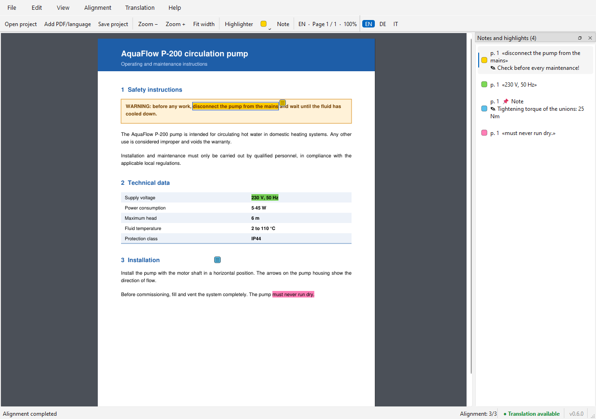
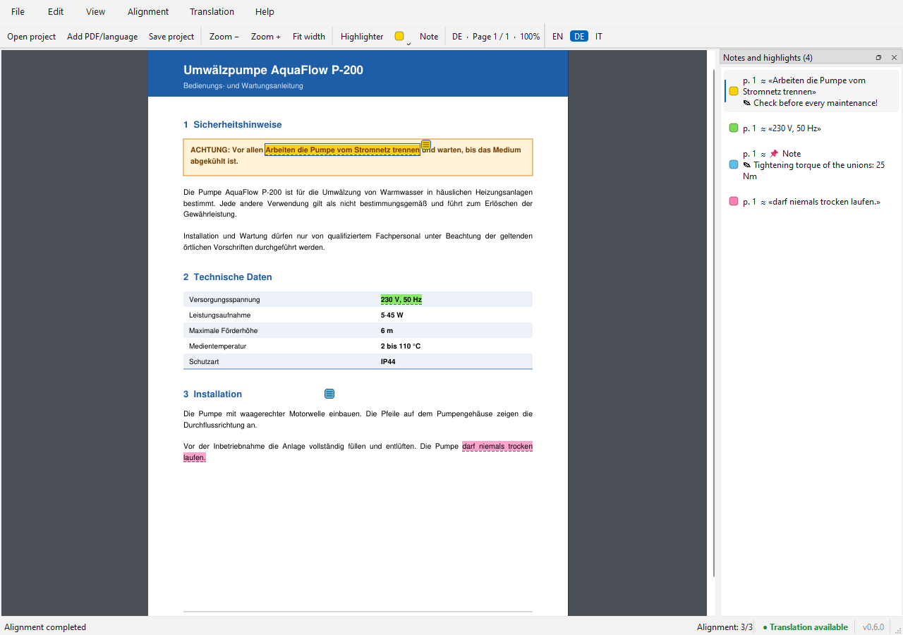
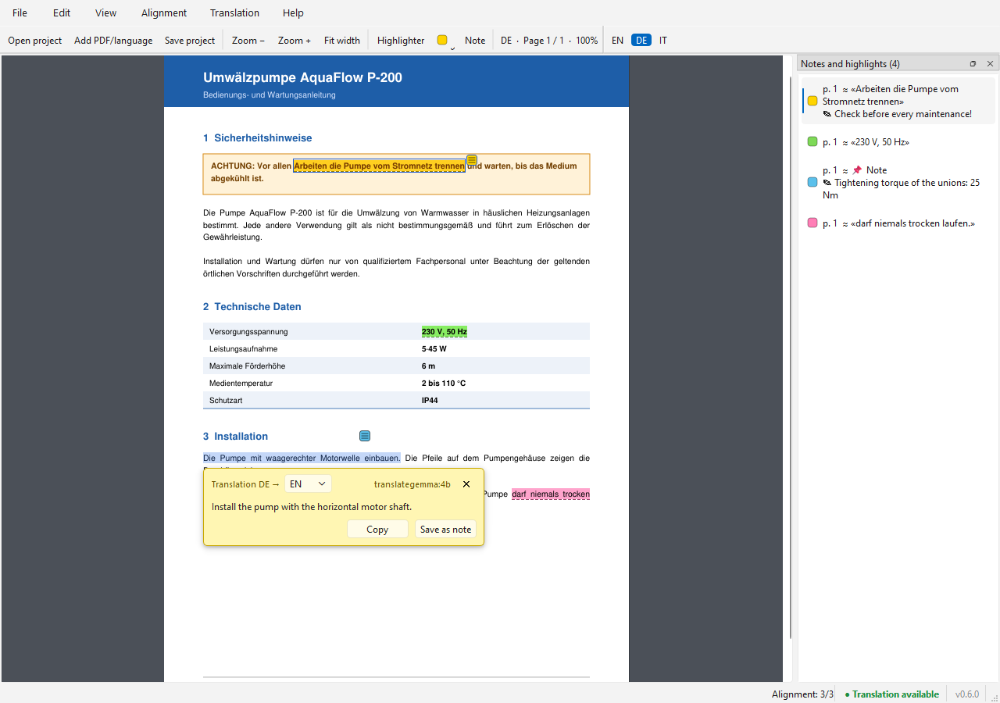
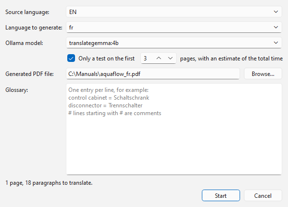

# PolyglotPDF

*[Leggi in italiano](README.it.md)*

A desktop reader for the **same PDF document in several languages** — for example a technical manual in Italian, German, French and English.
It works offline, with free local models. The interface is in English or Italian (chosen automatically from the Windows language, switchable in *Help → Language / Lingua*).

## Screenshots

*The manual shown is a fictional example created for these screenshots.*

**Highlights and notes** — the annotation panel on the right lists them all:



**Switch to German (`Ctrl+2`)** — same reading position; the highlights and notes appear on the matching German text (dashed underline = estimated position):



**Translate a selection** — the translation appears in a box anchored to the selected text:



**Generate a missing language** with a local model (here French from English):



## Features

- **Instant language switch that keeps your reading position** (`Ctrl+1…9`, `Ctrl+Tab`): the paragraphs of the different languages are aligned automatically.
- **Synchronised highlights and notes**: what you highlight in one language appears on the matching text in the others, with manual correction when needed. Export to standard annotated PDFs.
- **Translate a selection**: select some text → *Translate* → the translation appears in a box anchored to the selection (copy it or save it as a note).
- **Generate a missing language**: translates the whole PDF with a local LLM while keeping layout, images and graphics; background translation with resume, a glossary per language pair, and review of individual paragraphs.
- **OCR of scanned pages** (Tesseract built into PyMuPDF): the text becomes selectable, annotatable and translatable.
- **Semantic alignment** between languages through multilingual embeddings; without a model, a heuristic fallback based on numbers, acronyms and codes.

## Requirements

- Windows (developed and tested on Windows 11; the code is Python + Qt, other systems are untested)
- Python 3.10 or later
- Optional, for translation and semantic alignment: [Ollama](https://ollama.com) with the models

  ```bat
  ollama pull translategemma:4b
  ollama pull paraphrase-multilingual
  ```

  The **● Translation available / not available** indicator at the bottom of the window tells you whether Ollama was detected.

On a laptop without a dedicated graphics card the translation runs on the CPU: a few seconds for a short sentence, hours for a whole manual. With 8 GB of RAM the first loading of the model can take about a minute.

## Installation from source

```bat
git clone https://github.com/metfidan-dev/Polyglot_PDF.git
cd Polyglot_PDF
python -m venv .venv
.venv\Scripts\python -m pip install -r requirements.txt
```

Start: double-click `avvia.bat`, or

```bat
.venv\Scripts\python polyglot_pdf.py [project.polypdf.json | file1.pdf file2.pdf ...]
```

The package is called `pymupdf`: do not install the `fitz` package from PyPI, which is something else.
OCR data for languages other than Italian, German, French and English is downloaded by the app when first needed (from [tesseract-ocr/tessdata](https://github.com/tesseract-ocr/tessdata)).

## Quick start

1. **File → Add PDF/language…** (`Ctrl+L`) or drag the PDFs into the window; the language is suggested from the file name or the content.
2. Switch language with the toolbar or `Ctrl+1…9`.
3. Select text with the mouse: menu with highlight (5 colours), note, copy and translation.
4. **File → Save project** (`Ctrl+S`): a `.polypdf.json` file with the PDF paths, the annotations and the glossary.
5. **Translation → Generate missing language…** (`Ctrl+Shift+G`) to create a new language; start with the test on 2–3 pages, which estimates the total time.

## Windows executable

```bat
powershell -ExecutionPolicy Bypass -File packaging\build.ps1            :: installer (requires Inno Setup 6)
powershell -ExecutionPolicy Bypass -File packaging\build.ps1 -Portable  :: portable version (ZIP)
```

## Structure

| File | Content |
|---|---|
| `polyglot_pdf.py` | the application (a single file); the Italian interface texts are in `IT_TEXTS` at the end |
| `requirements.txt` | Python dependencies |
| `avvia.bat` | start with the `.venv` environment |
| `packaging/` | scripts for the installer and the portable version |
| `HANDOFF.md` | technical development notes: architecture, file formats, tests, known limits |

## Translating the interface

All interface texts are written in English in the code and wrapped in `_t("…")`; the Italian translations are in the `IT_TEXTS` dictionary at the end of `polyglot_pdf.py`, with the same `{placeholders}`. A text without a translation is simply shown in English.

## License

PolyglotPDF is released under the [GNU AGPL-3.0](LICENSE) license.

Third-party components: [PyMuPDF](https://github.com/pymupdf/PyMuPDF) (AGPL-3.0), [PySide6 / Qt](https://www.qt.io/qt-for-python) (LGPL-3.0), [NumPy](https://numpy.org) (BSD), [Tesseract](https://github.com/tesseract-ocr/tessdata) data (Apache-2.0). The models used through Ollama have their own licenses (TranslateGemma: Gemma Terms of Use).
